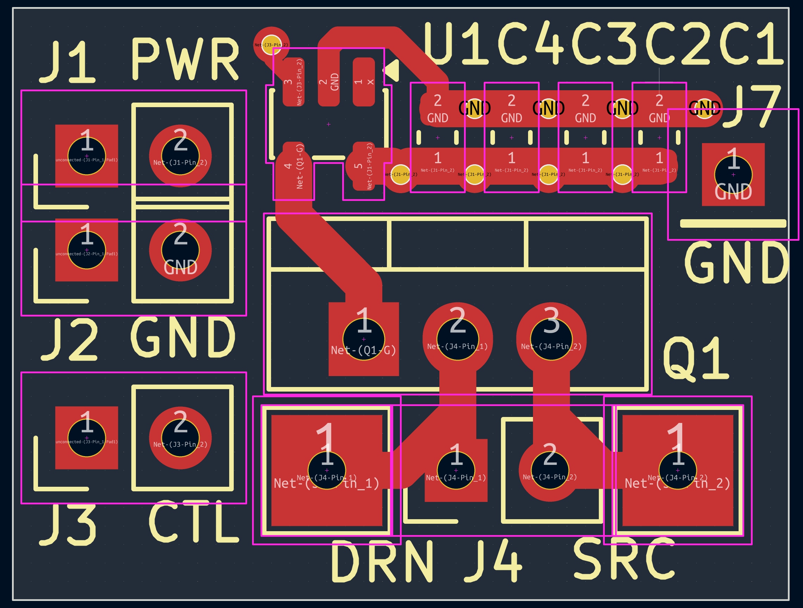
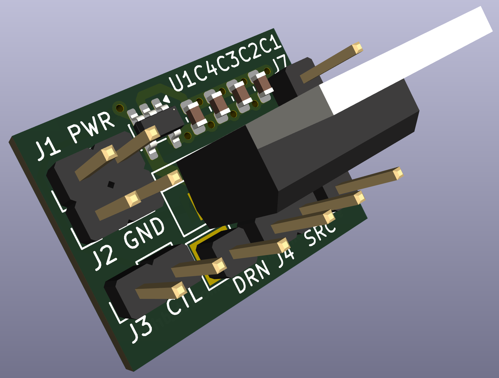
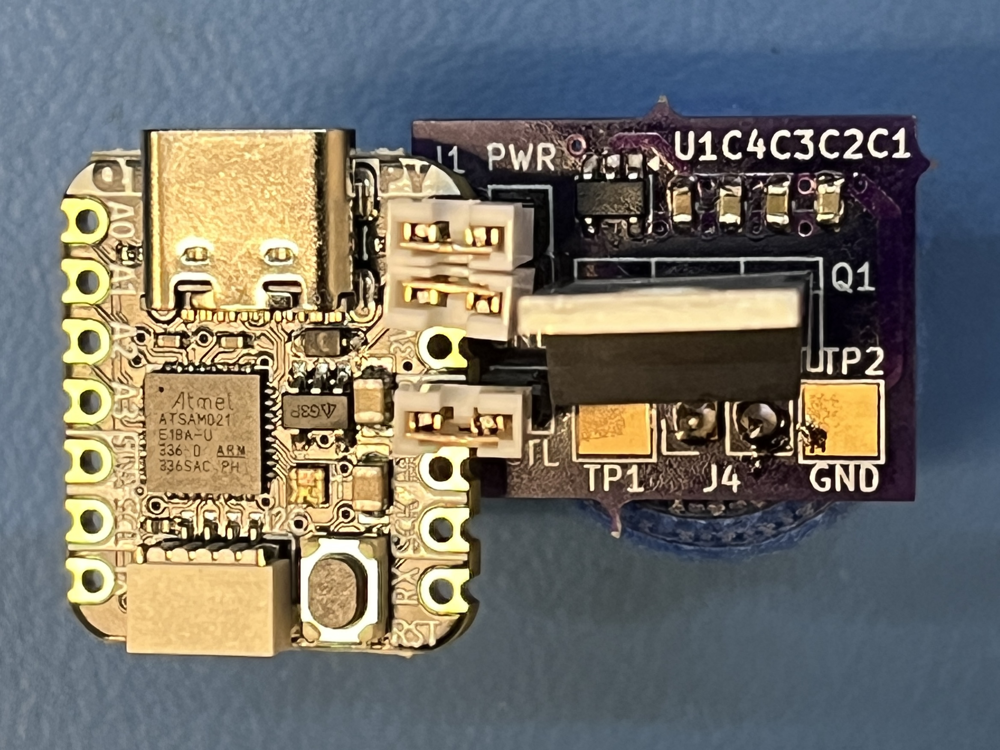

# mosfet_driver
MOSFET driver board which can connect to a Seeed Xiao (of Adafruit QT PY) MCU board. The outer left holes are to be shared with the right side of the MCU board. I am expecting to use jumpers to connect the 5V, GND and GPIO signals.

A MCP1416R mosfet driver is connected to a TO-220-3 package mosfet. I plan to use the USB 5V to power the MCP1416R and three 22uF ceramic caps (C1, C2 and C3) will provide the current needed to quickly turn on the mosfet (as ceramic caps have the lowest ESR). C4 I decided to make 0.1uF. My mosfet of choice is a IRFB7430PBF (40V, 195A).

Oshpark charged me $5.20 for 3 boards with Super-Swift-Service and USPS shipping.

I used a SAMD21 Adafruit QT PY board (as double-clicking the board button allows for easy UF2 drag-n-drop programming). The final UF2 file is in the tinyusb_src directory. See the python directory for a sample file to use with this UF2 firmware.

